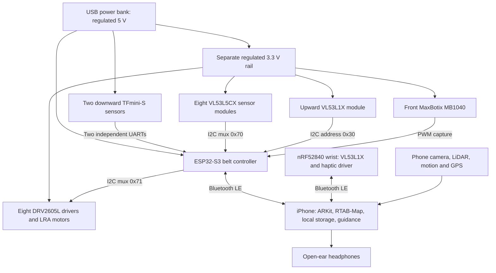

# Mobility hardware and phone connection

This is the reference **prototype** wiring matching the firmware. It has not been verified on a physical rig. A wearer should not rely on it for independent walking until the physical acceptance work below is complete.

The phone is the navigation computer. Wearables deliver additional range measurements and immediate local alerts. No internet connection or belt-to-wrist radio relay is required.

## Power and signals

Use a regulated 5 V supply with sufficient measured peak-current headroom; a 5 V / 3 A power-bank output and a separate 3.3 V / 2 A regulator are starting design capacities, not measured requirements or runtime claims. Add a power switch, appropriate fuse, strain relief and local decoupling. All belt boards share ground. Do not power the complete sensor/motor array from the XIAO's small 3.3 V output.

TFmini-S requires 5 V power but uses 3.3 V UART signaling. Power the selected SparkFun VL53L5CX boards at 3.3 V. Keep the muxes, pull-ups, DRV2605L modules and MB1040 logic on 3.3 V in this rig; verify the exact breakout-board schematic before assembly. GPIO is not a motor power source. Each LRA connects to its own driver's OUT+/OUT−. Configure rated voltage, clamp and resonance calibration for the actual chosen LRA before using it on a person.

Sources: [Benewake TFmini-S electrical specifications](https://en.benewake.com/uploadfiles/2023/03/20230331102010281.pdf), [SparkFun sensor board](https://www.sparkfun.com/sparkfun-qwiic-tof-imager-vl53l5cx.html), [DRV2605L datasheet](https://cdn-shop.adafruit.com/datasheets/drv2605L.pdf). TF-Luna, VL53L8CX, and other MaxBotix models are not interchangeable without checking supply, timing, framing and driver differences. The firmware profile uses TFmini-S, VL53L5CX, VL53L1X and **MB1040 LV-MaxSonar-EZ4**, not HRLV variants.

The wrist has its own protected battery and the XIAO's supported charging/power circuit. The wrist module and haptic driver use its regulated 3.3 V supply; check peak motor demand against the exact board regulator. There is no physical power or ground connection between wrist and belt.

## Belt pin assignments

Numbers below are MCU GPIO numbers, not arbitrary header positions. Choose the corresponding PlatformIO build environment; do not mix pin tables.

| Connection | XIAO ESP32-S3 default | ESP32-S3 DevKit alternate |
|---|---|---|
| Shared I2C SDA | GPIO5 / D4 | GPIO8 |
| Shared I2C SCL | GPIO6 / D5 | GPIO9 |
| Left downward sensor TX → MCU RX | GPIO44 / D7 | GPIO18 |
| MCU TX → left sensor RX | GPIO43 / D6 | GPIO17 |
| Right downward sensor TX → MCU RX | GPIO1 / D0 | GPIO16 |
| MCU TX → right sensor RX | GPIO2 / D1 | GPIO15 |
| MB1040 PW → interrupt input | GPIO3 / D2 | GPIO4 |

The downward sensors use their default binary UART output at 115200 baud. Cross TX to RX. The sonar's PW output is pulse width, not serial UART. The reference firmware uses 147 microseconds per inch for MB1040; verify that model and output on the bench.

The I2C trunk connects to both TCA9548A upstream SDA/SCL pairs and the overhead module. Set mux A to **0x70** (address pins low), mux B to **0x71** (A0 high, A1/A2 low). Each downstream branch has one module. Label both ends of every cable.

| Mux channel | 0x70 sensor branch | 0x71 haptic branch | Body direction |
|---|---|---|---|
| 0 | S0 / raw sensor ID 2 | H0 | Front |
| 1 | S1 / ID 3 | H1 | Front-right |
| 2 | S2 / ID 4 | H2 | Right |
| 3 | S3 / ID 5 | H3 | Rear-right |
| 4 | S4 / ID 6 | H4 | Back |
| 5 | S5 / ID 7 | H5 | Rear-left |
| 6 | S6 / ID 8 | H6 | Left |
| 7 | S7 / ID 9 | H7 | Front-left |

All VL53L5CX branches use 7-bit I2C address 0x29 (sometimes shown as 8-bit address 0x52 in vendor material). Only one branch of each mux is selected at a time. DRV2605L uses 0x5A.

The overhead VL53L1X connects directly to the trunk. At boot, firmware disables all ring branches, initializes the overhead module at its default 0x29, changes its address to **0x30**, and only then starts the ring. This avoids needing a third mux. A failed overhead address change must be corrected before treating ring startup as valid.

The original list's 4–6 ring sensors was insufficient to claim all-direction coverage. This profile uses **eight**. That still does not establish gap-free coverage: measure actual fields of view, occlusion by clothes/arms, and confidence near module edges. Eight directions in software are not a safety guarantee.

The ring starts at 4×4 zones and 5 Hz per sensor to leave I2C bandwidth for the other devices. Keep the upstream trunk short; a mux does not make arbitrary belt-length cabling electrically reliable. Measure rise time, capacitance and errors on the assembled harness. Use validated bus extenders or distributed sensor nodes if the cable runs exceed the electrical budget.

## Wrist wiring and meaning

Use the XIAO nRF52840's board-defined SDA/SCL pins (D4/D5 for this board), VL53L1X at 0x29 and DRV2605L at 0x5A on the same local bus. Its 3.3 V and ground feed those two modules, and the motor connects to the driver output.

The current wrist profile reports **pointing range** and gives local distance pulses. Its onboard IMU and the additional wrist sonar from `blind.txt` are not yet integrated. It does not claim an absolute pointing direction or treat a wrist-facing object as a body-front hazard.

## Phone connection and payloads

1. The user starts a Bluetooth scan in the app and selects the belt and wrist separately.
2. Each controller advertises the shared mobility GATT service. Firmware roles identify belt versus wrist; the app refuses role changes and duplicate roles in a connection session.
3. The phone subscribes to the hazard-summary and raw-measurement characteristics. Notifications carry binary readings, not video or AI responses.
4. Firmware evaluates hazards and drives local motors before sending bulk measurements. A phone command cannot override an active local urgent hazard.
5. The phone combines current wearable alerts with its local depth detector, and produces speech or a directional haptic command. The belt can alert even with the phone disconnected.

See [PROTOCOL.md](PROTOCOL.md) for byte-level framing. The app drops partial, duplicate, out-of-order and expired measurements. Wearable disconnects remain unavailable until reconnection or deliberate disconnection in the app. Pairing is currently BLE encryption/bonding without authenticated physical provisioning; owner enrollment and bond-reset UX remain release work.

## Which measurements build the map?

The phone's camera/depth/AR pose already share an ARKit coordinate system. Those feed the existing RTAB-Map iOS adapter. The eight belt modules report distances in their own fields of view; a belt that twists relative to the chest-mounted phone does **not** have a permanently fixed camera-to-sensor transform.

For that reason this implementation uses wearable readings for body-relative local alerts and diagnostics. It does not silently insert them as accurately located world-map points. Precise wearable-to-map fusion still requires measured sensor extrinsics, phone/belt relative pose estimation, clock synchronization with bounded uncertainty, and uncertainty propagation. MCU acquisition timestamps are carried now, but their clocks are not yet synchronized to ARKit. GPS selects an outdoor region; it does not determine a mall floor or exact indoor pose.

## Physical acceptance sequence

Vacuum magnetic boundary strips are not supported by the present sensor set or firmware. A compatible detector near the floor would be a separate hardware addition; see [keep-out areas and boundary strips](../maps/KEEP_OUT_AREAS.md). Saved map restrictions already work in the route planner and do not require that hardware.

Before walking tests, prove: each cable reaches the intended sensor; each H0–H7 command activates the correct motor; stable known-floor calibration completes; disconnected sensors produce unavailable status; step-down and overhead fixtures produce the expected alerts; phone Bluetooth loss leaves local alerts working; restored links reject old samples; simultaneous I2C traffic and motor pulses do not cause brownouts. Measure worst-case end-to-end alert latency and current consumption. Record device serials, mount angles and firmware versions with results.

Then validate mount motion, stairs/ramps, glass, dark and reflective surfaces, sunlight, crowds, battery depletion, app backgrounding and thermal load in supervised trials. No code-only test in this repository establishes everyday mobility readiness.
