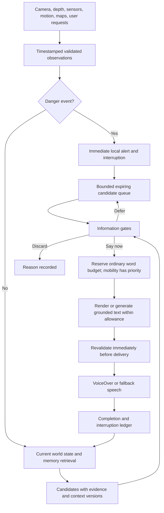

# Local memory and the information engine

Design status: proposed full system with partial native and relay integration. The [minimum checkpoint](MINIMUM_ASSISTANT_HANDOFF.md) records GRDB room/dialogue/preferences and speech-attempt history source, 37 Node checks and 15 context checks. Native compilation/device behavior, verified fact delivery, temporal world state and complete arbitration remain pending.

## Conversation, arrival and purpose

The situation combines the room map, current picture, sensor observations, localisation and separately established body/camera heading. It needs to know where within the room the person is, whether they just crossed a doorway, open-plan zones, relevant doors, their purpose and next destination. A room label alone cannot establish entry, left/right or a clear route. Preserve uncertainty and evidence revisions.

Persist the objective across intermediate rooms. For a bathroom inside the bedroom, arrival in the bedroom does not mean completion: acknowledge the transition briefly and supply the next supported navigation cue; omit a bed/art tour unless requested or something relevant changed. For sleep, the bed matters; for computer work, the desk matters. A new question may expand description without changing destination. An explicit change of plan supersedes the old objective and invalidates pending directions. Ask one concise clarification when the destination is ambiguous; do not interrogate the user at every doorway.

The navigation adapter supplies measured route distance in preferred units, fresh relative turn information and source validity. A captioning model must not invent them. Step estimates, if enabled, are approximate and calibrated to the person's actual stride, with a distance alternative and uncertainty; do not convert guessed geometry using a population-average stride. Closed-loop progress and turns remain necessary: a long step count is not a route controller.

The current relay accepts up to six dialogue turns, a goal revision and a recent map-consistent arrival. These are supplied inputs, not a working persistent conversation, localisation or route planner. The synthetic bathroom tests exercise context selection only. Native capture, memory, speech input/output and post-generation goal/pose revalidation remain required.

Learn attention habits from repeated requests and corrections through M09, using established persistence and sourced records. Keep explicit preferences separate from suggested patterns; make suggestions reviewable, editable and removable. Current intent overrides habits. Do not infer ability, sensitive traits or permanent preferences from a single question or silence.

## Information is the shared foundation

The assistant supplies useful visual information for the person's own understanding, choices, enjoyment, social participation and movement. Its world state must include appearance, relationships, activity, people, options, goals and changes, as well as geometry and obstacles. Avoid reducing a scene to object names or a route-clearance result.

Danger and due mobility cues have delivery priority; they do not define the whole product. Perception and memory continue to support rich awareness, with output at the person's selected information rate. Missing indoor localisation can block a directional claim while leaving a valid clothing description, sign reading, comparison or remembered place overview available. Family-recognition readiness is not a prerequisite for describing an observed anonymous person or activity.

The first M2 experience integrates these producers through the existing-model adapter and speech engine. Useful description/discovery does not wait for the M3/M4 route and identity milestones. The acceptance plan includes independent information outcomes, not just navigation success.

## Storage decision

Use an app-private GRDB/SQLite database for structured memory and app-private files for large assets. Start with typed queries and full-text search; introduce embeddings only if measured retrieval gaps justify another model and index. GRDB is persistence, not an LLM memory-extraction engine. Reuse its transactions, migrations and query APIs rather than implementing a database or treating free-form notes as the sole source of truth.

Proposed layout inside iOS Application Support:

```text
AssistantMemory/<profile-id>/memory.sqlite
AssistantMemory/<profile-id>/Assets/People/<person-id>/...
AssistantMemory/<profile-id>/Assets/Places/<place-id>/<revision>/...
AssistantMemory/<profile-id>/Exports/...
```

Paths and table names above are design names, not files already on a user's device. Existing `Places` and `Journeys` directories remain intact until an idempotent migration is implemented and checked. Use stable opaque IDs, not people's names or addresses in filenames. Database sidecar files need the same protection and backup policy as the database.

Keep API tokens and encryption keys in Keychain, not these tables or exported notes. Apply platform file protection deliberately; verify lock/unlock and accessibility requirements on device. A SQLite file is not automatically independently encrypted. If SQLCipher is required, evaluate its build and key lifecycle explicitly. Do not claim that GRDB itself solves encryption or backup.

Use transactional database snapshots for export; do not copy an open WAL database as an arbitrary file. Asset staging plus a manifest and recovery cleanup must handle the fact that filesystem writes and SQLite commits are not one transaction. User-controlled backup can follow the core implementation; current place storage excludes backup, so do not silently promise cloud recovery.

## GitHub, folders, and AI memory products

No GitHub account is required for the app. GitHub's documented personal-account flow involves user signup and verification; connecting a GitHub App to an existing account is different from creating that identity. Do not add unattended personal-account provisioning. [GitHub account documentation](https://docs.github.com/en/account-and-profile/how-tos/account-management/creating-an-account-on-github)

The Git-backed memory idea is real: [Letta Code's MemFS](https://github.com/letta-ai/letta-code/blob/70ead33535e281eb7febcc3c886fe7cf387cd5cd/README.md) supports Git memory and an optional chosen GitHub repository. It is a desktop/server agent runtime, not our selected iOS persistence layer. If we later offer such export, make scope, visibility and retained revision history explicit. A private repository is not equivalent to local-only storage, and deleting a current file is not the same as deleting old revisions.

Folders suit photos, meshes and exportable notes. The database handles relationships, time, correction, deletion and retrieval. A readable Markdown/JSON export can satisfy the user's personal-repository analogy without requiring Git in the phone's live sensing loop.

## Memory types and proposed records

| Type | Records | Lifetime and use |
| --- | --- | --- |
| User profile | Communication settings, explicit likes/dislikes, sizes, budgets, dietary preferences the user provides | Durable and editable. Preferences help ranking without removing alternatives. Never infer personality or sensitive attributes from appearance. |
| People | Stable ID, user-provided name/bio/relationship, enrollment permission, approved reference assets | Durable identity registry; independent of momentary detection/track IDs. Family membership comes from the user, not image inference. |
| Places | Venue/floor/room IDs, connected landmarks, geometry revision, semantic descriptions and reference assets | Durable, versioned map knowledge. Appearance can be remembered; present clearance needs current evidence. |
| Outing and objective | Entry/exit intent, companions, visited landmarks, coordinate-frame changes, task history, active/suspended/completed objectives | Persist useful continuity. On restart, recover goals and history but mark live location unknown until established. |
| Episodes and facts | Source event, subject, predicate/value, event time, recorded time, validity, provenance, revision, explicit/inferred/confirmed status | Store useful events rather than every frame. Corrections supersede facts; retain explainable history according to retention preferences. |
| Live world state | Pose/frame ID, tracked entities, current hazard, activity, map alignment quality, evidence expiry | Primarily transient. Session-specific monotonic timestamps must not survive a restart as current facts. |
| Speech ledger | Candidate ID, fact versions, objective/map revisions, attempted/start/completion/interruption status | Short, bounded history for deduplication and repeat. Posted does not mean heard. History can suppress repeats only under defined delivery rules. |

Every durable fact needs profile scope, source, recorded time, and correction/deletion behavior. Spatial facts additionally need coordinate frame, map revision and location quality. Transient observations need capture time and expiry. Confidence scores are model/sensor outputs, not calibrated probabilities unless separately measured.

Location statements have distinct forms: current observed, remembered layout, last seen, and unknown. Losing a person from view does not prove they left the room. A phone rotation is not necessarily a body rotation. Standing versus sitting must remain unknown if available evidence cannot distinguish them.

## The engine before speech

### Situation supplied to the model

An image plus a generic description prompt is insufficient for the intended experience. Assemble a bounded, versioned situation snapshot from the existing localisation/perception adapters and memory before ordinary generation. The model interprets observations in this context; it does not manufacture current pose, room identity or building connections from language plausibility. Missing fields remain explicitly unknown and only constrain claims that need them.

| Context | Required meaning | Example use |
| --- | --- | --- |
| User pose and facing | Current position/frame, floor, body-facing estimate, camera orientation separately, timestamp and localisation quality | Relate a supported observation to the person after a turn; do not turn camera-left into user-left without alignment. |
| Place identity and hierarchy | Stable room/zone ID, containing home/building/venue, floor, store/restaurant within the mall, source and revision | Know that this is a restaurant dining area on a mall floor, rather than a disconnected picture of tables. |
| Place connections | Doors/exits, adjacent rooms/corridors, floor transitions, known entry, route graph and current blocked/unknown segments | Explain where this room sits within the larger place and preserve a route/exit objective even when the doorway is outside view. |
| Live observations | Image/depth/range evidence, capture times, coordinate frames, objects, relationships, motion and coverage | Describe a fish tank near a known landmark; distinguish observed table occupancy from unobserved areas. |
| People and relevance | Track IDs, supported enrolled identity, user-supplied relationship, companion/meeting status, current versus last-seen position, observed role/activity | Prioritise a companion's movement or a staff member approaching without assuming every person needs announcing. |
| Current activity and objective | Moving/seated/unknown, conversation context, immediate task, broader outing, pending actions, return intent | Shift from reaching the restaurant to finding the host, then reading a menu, without forgetting the exit or companion. |
| Interests and preferences | Relevant explicit likes/dislikes, clothing colors/styles, fish tanks, food preferences and corrections | Offer an aquarium or preferred clothing color as a useful discovery while still exposing alternatives. |
| Communication state | Selected information budget/detail/frequency, what was already delivered, current speech, interrupted items and deadlines | Avoid repeated descriptions, fit the available words and resume useful content after a higher-priority event. |
| Action state | User-authorized reservation request, selected branch/time/party, provider result, pending/confirmed/failed/unknown status | A confirmed booking becomes outing context; an attempted or timed-out request is not announced as a reservation. |

Place containment and navigable connections are distinct relationships. A store can be inside a mall while its entrance connects to a particular corridor; an exit has a destination, floor and source revision. Reuse the existing map representation and reviewed persistence libraries for these records. Do not create a new SLAM or routing algorithm to make this contract concrete.

Resolve relevant memory by stable person/place/objective IDs and explicit interests, rather than stuffing the whole private history into every model call. Give the model the selected evidence, source age, coverage, known/unknown distinctions, allowed spatial claims, user question and remaining word allowance. Existing local danger handling remains independent of snapshot retrieval and generation.

The provider adapter must associate proposed statements with their supporting evidence/context versions and separate observation, remembered fact and recommendation. Validate those associations before speech and revalidate spatial/person claims after delays. A prompt that asks the model to be accurate is not a substitute for current source data. This is an app integration contract, not an existing feature or a newly trained model.

### Selection within the situation

Danger preempts immediately, and due movement/orientation cues come next. Within ordinary information, consider the current question/goal, meaningful changes, relevant people, explicit interests and opportunities to discover something new. Preferences influence what to offer; they neither establish that an object exists nor determine the user's decision. A fish-tank interest can promote a currently observed tank or a clearly labelled map listing, but cannot justify inventing one.

Use useful aggregates where evidence allows them: a few occupied tables, several apparently unoccupied tables in the observed area, the overall décor, then details relevant to the user. Do not enumerate every chair by default. Partial coverage must not become a claim about the entire room. An apparently empty table is not necessarily available for seating, and a person approaching is not necessarily a waiter or someone intending to talk.

Follow-up can expand any supported detail within the user's controls. Selection suppresses unnecessary speech while preserving access to useful information; it must not permanently hide choices that the assistant did not initially rank highly.



The danger path does not wait on a database, identity model, LLM, cloud, word budget or ordinary queue. It retains the existing local detector validity/age checks without adding a slow secondary review. The exact priority order is danger, then mobility/orientation, then rich awareness/discovery/description. Time-critical route cues use the current route/pose/revision and their own priority class. Necessary mobility cues bypass the ordinary narration budget; ordinary guidance explanations can use the full engine. Do not treat all text mentioning mobility as danger.

Most gates are local typed checks, not a chain of LLM calls. One immutable context snapshot per decision makes reasoning reviewable and avoids mixing a person's old identity with a new position. Re-run validity after slow generation and when dequeuing, because facts may have changed.

| Gate | Checks | Result |
| --- | --- | --- |
| 1. Evidence | Capture age, source availability, supported claims, contradictions | Keep current evidence; downgrade to labelled memory/last-seen when appropriate; reject unsupported assertions. |
| 2. People | Detection/track/identity association, enrollment, ambiguity, occlusion | Name only when supported; otherwise anonymous description. Do not merge tracks based on clothing alone. |
| 3. Space | Localisation, floor, frame transform, heading quality, map revision, actual visibility | Permit only supported relative directions/distances. Unknown position does not block nonspatial descriptions. |
| 4. Intent | Active objective, pending tasks, requested focus, discovery opportunities | Rank relevant candidates; preserve unsolicited useful discovery and user choice. |
| 5. History | Fact versions already delivered, recent repetition, place familiarity, uncompleted speech | Prefer changes; explicit repeat overrides suppression. Do not suppress an unspoken candidate as already heard. |
| 6. Activity | Moving/stationary/unknown, companions, conversation/listening state, observation change rate | Adapt timing and freshness. Never force minimal detail just because moving; a companion/guide dog is not evidence of clearance. |
| 7. User controls | Detail, words per time window, frequency, interests, automatic/on-request mode, quiet/repeat commands | Set and enforce the ordinary information budget independently of VoiceOver speed. |
| 8. Output state | Current utterance, interruption policy, candidate deadlines and queue capacity | Say, defer, coalesce, replace, or discard with a reason. |

Queue candidates with stable semantic keys, not an endless FIFO of finished paragraphs. New state replaces an older pending update for the same subject. Separate short urgent cues from longer scene descriptions. Bound both count and useful lifetime; long speech must not create an old-world backlog. Start with configurable prototype limits, then tune through user feedback; do not invent universal safe intervals.

At urgent interruption, invalidate queued directions tied to the old pose/route. Resumable descriptive content is revalidated before continuing. User questions should get a response without starvation, and discovery should not disappear indefinitely behind routine route chatter.

## Adjustable information rate

The user explicitly requires control over words produced within a time period, not only short/long descriptions or speaking speed. Expose an accessible information-rate control (words per minute or equivalent labelled presets with the actual value available), independently of detail per description and update frequency. Preset values must be evaluated with users; no universal comfortable rate is assumed. A high budget permits rich content but is not a target the app must fill with unnecessary words.

For ordinary speech, use a rolling time window and a bounded pending-word allowance. Reuse established clock/event primitives and platform language-aware word segmentation; keep only the small domain accounting adapter custom. Model tokens are not words, and whitespace splitting alone is not an adequate multilingual contract. Verify the chosen tokenizer with Arabic and English fixtures.

Before generation, reserve an allowance from the remaining ordinary budget and pass that size to the renderer/model. A prompt limit alone is not enforcement. Validate the resulting word count, supported claims and sentence completeness before queue admission; if oversized, request or select a shorter complete grounded chunk. Do not cut a negation, direction or sentence midstream to hit a number. Release cancelled/unsubmitted reservations, recheck before dispatch, and invalidate obsolete reservations when settings change.

Maintain a budget ledger separately from delivered-history semantics. Count words admitted to ordinary speech conservatively even when the announcement is later interrupted; UIKit cannot reliably report exactly which words the person heard. Record attempted/completed/interrupted status separately. Account for queued reservations as well as dispatched content so asynchronous producers cannot each spend the same remaining budget. Use monotonic time within a session and do not restore a prior session's timestamps as current.

When capacity is exhausted, coalesce or defer useful fresh content, drop stale descriptions and keep the full supported detail available on request. An explicit request for a longer description can offer a temporary budget increase through accessible controls; never silently override the user's chosen rate. Lowering the budget takes effect on pending content; raising it must not flood speech with an old backlog. Current-utterance behavior must be documented and tested rather than constantly interrupting the listener.

Danger bypasses this accounting immediately. Necessary mobility/orientation cues also remain deliverable; their actual speech occupancy can defer ordinary descriptions without debiting or suppressing the danger path. A faster VoiceOver rate may free the speech channel sooner, but does not authorize exceeding the selected information budget. A slower rate still requires queue bounds and completion handling. See [attention research](ATTENTION_AND_SPEECH.md) and SPE-16–SPE-19 in the [test plan](ASSISTANT_TEST_PLAN.md).

## VoiceOver integration

Keep the user's VoiceOver voice and speed. Use documented announcements for selected text without moving accessibility focus to a changing label. Ordinary queued speech and urgent interruption need different delivery policies. Observe announcement completion and cancellation; iOS remains responsible for actual scheduling. A failed or missing completion callback needs a bounded recovery path, not permanent silence or blind replay.

Respect deliberate screen-reader navigation and an active conversation. Controls remain accessible while hands-free awareness runs. Provide pause, resume, repeat, more/less detail and changes-only commands; accessible UI equivalents remain available when voice input is unavailable. Do not advertise locked/background camera awareness when the OS has suspended capture.

The current app blocks automatic descriptions under VoiceOver in both `NavigationModel.readScene` and `Feedback.speakAmbient`. Removing one guard is insufficient: first implement arbitration, stale-event replacement, completion handling and the control settings. Update `SceneContext`, `AttentionPolicy`, the local prompt budget and server prompt policy together so user-selected detail is preserved end to end.

## Proposed component boundaries

| Component | Responsibility | Reuse |
| --- | --- | --- |
| Memory repository | Transactions, migrations, facts/episodes/profile queries | GRDB/SQLite adapter; existing PlaceStore/JourneyStore migration. |
| World-state coordinator | Consistent current pose, map and entity revisions | Existing ARKit/RoomPlan/RTAB-Map integration; new app-specific coordination. |
| Candidate producers | Place overview, person/activity changes, goal opportunities | Existing models/recognisers; Soundscape callout patterns. |
| Information policy | Gates, priorities, budgets, expiry and explanatory decisions | New small domain policy; tested upstream event primitives around it. |
| Speech coordinator | One speech owner, preemption, completion and history | Soundscape lifecycle reference plus UIKit/AVFoundation APIs. |
| Optional memory/provider bridge | Scoped context retrieval, proposed memory updates, room processing jobs | Evaluate one backend; Dot/plugin contract only after verified access. |

These component names are proposed interfaces. No reviewed repository supplies this complete domain engine ready to drop into an iPhone. Reuse the foundations and write only the necessary integration and product policy, with explicit acceptance tests.

## Dot and cloud boundary

Dots can retain notes and use connected plugins, but signing in to ChatGPT does not automatically expose all ChatGPT/Dot memories to this app. This session's tools expose no authenticated Dot control/memory connection; plugin discovery did not find one. No account was accessed or modified.

Proposed future tools: read a user-approved context subset; propose a preference update; get a selected place package; submit a bounded enhancement job; return a downloadable artifact. These are design contracts, not existing OpenAI endpoints. Do not expose arbitrary paths, entire histories, permanent face databases, or app control by default.

Also plan a reservation-action bridge when a supported Dot/provider connection is established (A05). Account connection alone is not an instruction to book. Execute within the user's actual reservation request and specified limits; preserve the selected venue/branch, local time, party size, provider confirmation and cancellation/status reference. Resolve ambiguous or timed-out results before retrying so a network failure cannot produce duplicate bookings. Pass a confirmed venue into the local outing objective, while retaining entrance/return context. This session has neither verified a booking connector nor made a reservation.

A room artifact must identify schema, units, coordinate frame, source scan revision, measured versus generated attributes, timestamps, file hashes and size limits. Import validates structure and stages changes transactionally; does not execute code from the package. A Dot-produced decorative mesh never silently replaces measured clearance geometry. Revoke connection, delete exported data and resume offline behavior must be explicit flows.

References: [Dot memory](https://learn.chatgpt.com/docs/dots/tasks-and-memory), [Dot tools](https://learn.chatgpt.com/docs/dots/computers-and-apps), [ChatGPT sign-in scope](https://developers.openai.com/siwc/quickstart), [Apple RoomPlan](https://developer.apple.com/augmented-reality/roomplan/), [Apple announcement queue](https://developer.apple.com/documentation/uikit/uiaccessibilityspeechattributequeueannouncement). Upstream-specific sources are in the [review](ASSISTANT_UPSTREAM_REVIEW.md).
