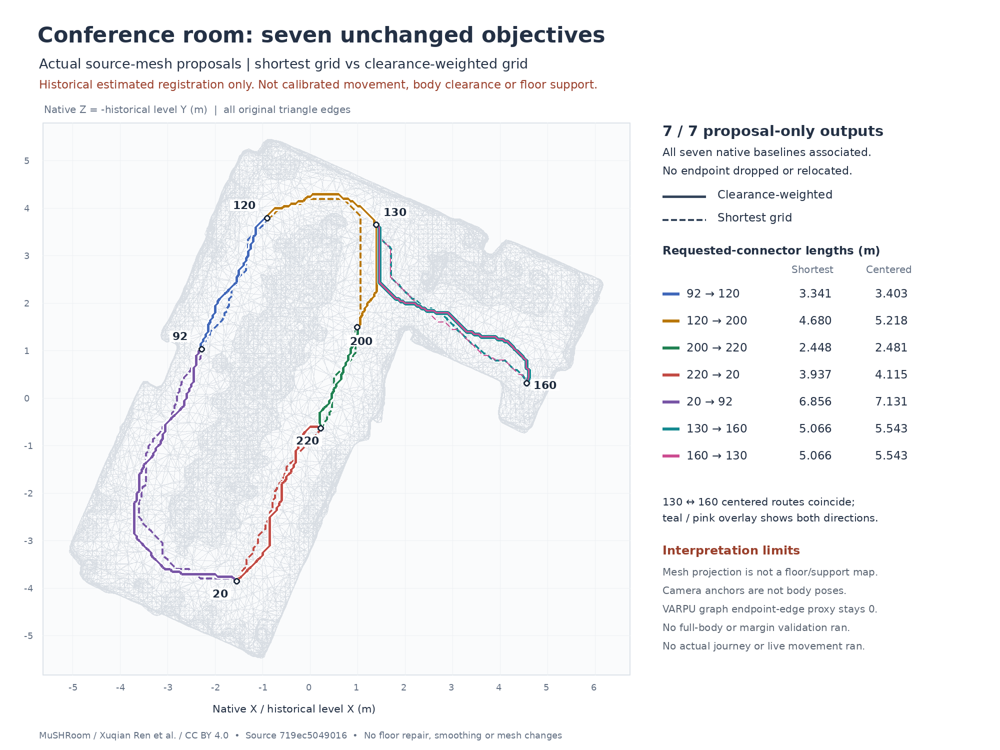

# Conference native comparison — actual attempt002 result

**The guarded comparison completed with zero exit, producing seven geometry-only proposals. It did not establish seven physical journeys, collision-free routes, floor support or camera-to-mesh calibration.**

## Exact execution and scope

- Admitted source: `719ec504901639f65767b717f7f7dc817a482640`.
- Attempt: `conference-native-comparison-attempt-002`; terminal receipt `completed-zero-exit`.
- Controls: **26 passed**, exit 0, scope pure graph/ranking controls. Comparator exit 0; both process groups retired.
- Retained objectives: **7 / 7 native complete-and-associated baselines; 7 / 7 grid proposals; 0 disconnected; 0 unavailable**. Every grid status is `proposalOnlyAwaitingHardValidation`.
- Graph: 7,509 nodes and 56,570 directed edges. Fixed original requested endpoints and pose indices are unchanged; no difficult endpoint was omitted.
- Observed resources: 7.148675 aggregate CPU seconds; 7.165927929 wall seconds; 130,326,528 bytes observed aggregate peak RSS. Unchanged caps: 120 CPU seconds / 180 wall seconds / 1 GiB observed RSS / 16 MiB output. Observed RSS is not a hard cgroup ceiling.
- Source/input pins matched before and after. This review performed only read-only arithmetic/hash verification and raster rendering; it did not rerun routing or native controls.

## All seven length comparisons

Lengths below are recomputed full-XYZ polylines **including exact requested-start/projected-start and projected-goal/requested-goal connectors**. They are geometry lengths, not measured walking distances. Native baseline and sampled grid paths are different proposal representations.

| Objective | Native baseline (m) | Shortest grid (m) | Clearance-weighted grid (m) | Added vs shortest |
| --- | ---: | ---: | ---: | ---: |
| Table 92 → 120 | 3.110301 | 3.341246 | 3.403184 | 0.061938 m / 1.85% |
| Table 120 → 200 | 4.463919 | 4.679777 | 5.217547 | 0.537770 m / 11.49% |
| Table 200 → 220 | 2.282963 | 2.448448 | 2.480559 | 0.032111 m / 1.31% |
| Table 220 → 20 | 3.677079 | 3.936778 | 4.114779 | 0.178001 m / 4.52% |
| Table 20 → 92 | 6.380088 | 6.856408 | 7.130919 | 0.274511 m / 4.00% |
| VARPU 130 → 160 | 4.752949 | 5.066144 | 5.542600 | 0.476456 m / 9.40% |
| VARPU 160 → 130 | 4.752949 | 5.066144 | 5.542600 | 0.476456 m / 9.40% |

The five table-leg length sums are **19.914349 m native / 21.262657 m shortest grid / 22.346989 m clearance-weighted grid**. The latter adds 1.084332 m (5.10%) over the shortest-grid sum. This sum is not an executed loop or a continuous same-actor/body-orientation test.

All graph-path lengths remain within the unchanged `1.5 × original unfiltered shortest-grid length + 0.5 m` cap. That cap is defined on graph paths, not on external requested connectors; both representations are separately recorded in `RESULT_REVIEW.json`. No smoothing or shortcutting was added.

## What centering improved — and what it did not

These are stored **residual navmesh-wall graph proxies**, not body/margin clearance, collision checks or physical measurements. “Interior” excludes graph edges incident on the start/goal anchor. The all-edge graph minimum includes those incident edges but **does not score the external requested connectors**. Exposure cost is the unchanged length-weighted graph ranking score.

| Objective | Graph minimum: shortest → centered (mm) | Interior minimum: shortest → centered (mm) | Exposure cost: shortest → centered |
| --- | ---: | ---: | ---: |
| Table 92 → 120 | 11.353 → 37.149 | 48.403 → 101.029 | 15.835882 → 8.914393 |
| Table 120 → 200 | 0.000 → 63.095 | 0.000 → 63.095 | 41.870518 → 12.870803 |
| Table 200 → 220 | 77.674 → 88.293 | 220.572 → 252.294 | 4.584667 → 4.130080 |
| Table 220 → 20 | 0.657 → 113.831 | 20.580 → 175.749 | 21.175570 → 8.139579 |
| Table 20 → 92 | 0.000 → 33.691 | 0.000 → 33.691 | 96.373451 → 21.922477 |
| VARPU 130 → 160 | 0.000 → 0.000 | 0.000 → 70.804 | 68.012261 → 17.815408 |
| VARPU 160 → 130 | 0.000 → 0.000 | 0.000 → 70.804 | 75.061354 → 17.815408 |

- Interior graph minima improved for all seven objectives, and exposure costs decreased for all seven. The extra connector-inclusive lengths range from 1.31% to 11.49%. These are proxy trade-offs, not a safety success rate.
- All-edge graph minima improved for the five table legs. **Both VARPU directions still have a zero graph minimum on endpoint-incident edges**, despite a 70.804 mm interior proxy. This known limitation must not be hidden by reporting only the interior tier.
- VARPU centered geometry is exactly the same path reversed. Its two shortest-grid paths have equal length but differ in tied-route geometry/exposure cost. They are two directional objectives, not independent physical scenes.
- No manual repair, FARO data, floor patch, changed triangle or native exclusion was introduced. The manual-repair arm remains unavailable, not replaced by a claimed pass.

## Attempt001 remains failed; geometry is unchanged

Attempt001 at source `d40c1e193511305364c90b42e1c44038d901c0cb` had controls exit 0 and comparison exit 1 because final pin verification read a route-start list through a shadowed argparse variable. Its failed receipt and logs remain intact. The narrow `cli_args` repair changed no geometry: **the complete attempt001 and attempt002 `PROPOSALS.json` files are byte-for-byte identical**, SHA-256 `0f50fbbd52df3fa4369c0784579a93a2461b6c765b052acb2daf51d15f5f290f`.

Only attempt002 has a successful terminal software receipt. This does not retroactively relabel attempt001 or promote either proposal file to physical acceptance. See the [preserved failure summary](../conference-replay-source-20261029/ATTEMPT_001_FAILURE.json) and [repair controls](../conference-replay-source-20261029/ATTEMPT_002_PREPARATION.json).

## One original-mesh overview

The renderer reads all 18,398 vertices and 29,366 original triangles without selection, repair, face deletion or resampling. A standard-library implementation of the exact fixed historical OBJ→level transform reproduces the admitted transformed Float32 vertex and Int32 triangle digests before drawing. The figure uses native X and native Z = minus historical level Y. All original triangle edges and all requested-connector paths are rendered; height is omitted by the orthographic view. **It is not a floor, occupancy, support or calibrated localization map.** The reverse VARPU centered route coincides with the forward route and is shown as a two-color overlay, not moved sideways for visibility. Labels identify source camera-anchor indices, not physical body poses.

Source attribution: Xuqian Ren et al., MuSHRoom, CC BY 4.0. This is a transformed raster visualization of the original public Koivu mesh; its registration is a historical estimated comparator, not official camera-to-mesh calibration. Exact official source/member/hash records remain in the [input inventory](../conference-replay-input-inventory-20261029/) and extraction helper. No archive, original mesh, raw pose/route array or private capture is included in this report packet.

## Remaining acceptance boundary

The actual body remains 0.45 × 0.30 × 1.60 m plus a separate 0.15 m horizontal margin. Native radius 0.225 m and height 1.75 m are proposal settings, not a rectangular-body validation. Full-body sweep, margin, complete-footprint support, current sensing, calibrated camera/body pose, facing/turning, deviation/recovery and continuous movement are not established. Missing mesh surfaces cannot become clearance. `physicalAuthority=false` and `movementExecuted=false` remain unchanged.

## Reproducibility and evidence

- [Machine-readable reviewed metrics and source digests](RESULT_REVIEW.json).
- [Read-only review and raster source](review_result.py); bounded command from repository root: `timeout 20s python -B research/conference-native-comparison-result-20261029/review_result.py`. It reads existing attempts and the original mesh; only Pillow raster drawing is imported beyond the standard library, never the native planner.
- Actual terminal receipt SHA-256: `b0f460f9ed879be0ee00e43d02213c71799d6d34cb6b238e664c8e6648f9ae94`.
- Single overview PNG SHA-256: `232a1fa8383ef7ab18a18f00bc14781ae9f28f22eb9a08c9c404a03978ee85d9`.
- Root retains publication authority; this review did not commit, push, upload an archive or change the completed attempts.
