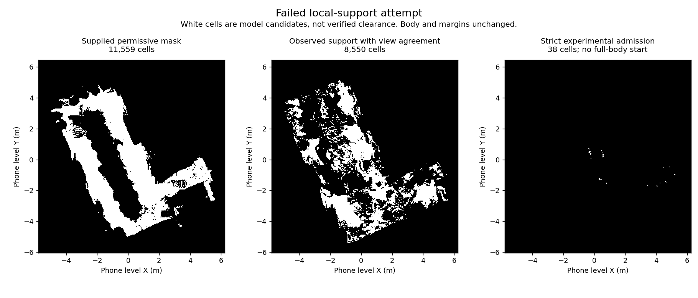

# Failed local-support movement attempt

The user asked to try implementing the correction and moving the simulated person.
This branch preserves the implementation and actual result, including its failure.

**Result: this experimental correction did not produce usable movement. Do not adopt it.**
It retained observed small residuals and unknown support, but its permanent uncertainty
veto recreated excessive blockage. This is a policy failure, not evidence that Koivu
is impassable or that iPhone hardware cannot support navigation.

## Executed

- Froze `PROTOCOL.json`, source identity and twenty start/goal pairs before building the new map.
- Pair selection used only the supplied split-0.7 mask. Baseline candidate count: 1,309.
  No reference, corrected-map results or recorded camera trajectory selected the pairs.
- Reprojected all 294 original depth frames and verified their source hashes/associations.
- Used saved valid Open3D per-view planes as estimators, with no pose or scale changes.
- Built a compact phone-only map preserving body/head occupied and unknown evidence.
- Ran eight floor-adapter fixtures and five footprint/sweep fixtures: all thirteen passed.
- Executed twenty frozen pairs times five repetitions: **100 admission attempts**.
- Separately tried three non-floor, fixed-scale Open3D rigid ICP comparisons. None was adopted.

The body remains 0.45 x 0.30 x 1.60 m, with 0.15 m horizontal margin. Recast uses
one circumscribed-body radius plus that margin, not the earlier double bounding.
This remains conservative for orientation-aware passages. Actual rectangular
admission checks also failed for all frozen starts.

## Results

| Outcome | Count |
| --- | ---: |
| Attempted start admissions | 100 |
| Invalid starts under the experimental phone map | 100 |
| Arrivals | 0 |
| Stops after an admitted start | 0 |
| Movement failures after an admitted start | 0 |
| Episodes with movement | 0 |
| Travel distance | 0 m |
| Physical/reference collisions | Not evaluated: no movement admitted |

The JSON's `collision: 0` is an attempt-category count, not a measured collision rate.
`physicalCollisionOutcome` and `physicalArrivalOutcome` remain null. These are not
100 completed movement journeys. No standing-still success is reported.
The native build attempt returned `no supported walkable polygons`.

The new map has 8,550 cells with observed support and the required inter-view height
agreement, but only 38 cells survive all admission gates. No full-body circular
centre survives, and every frozen start fails its actual rectangular footprint.
The supplied baseline had 11,559 permissive walk cells. No new walk cell was admitted.



## What went wrong in this attempt

The adapter required supporting endpoints within 2 mm of a valid per-view plane in
three views, then permanently rejected a cell if any view supplied an unresolved
positive or negative residual. Two positive-residual views above 5 mm blocked it.
These are explicit experimental resolution requirements, not calibrated sensor accuracy.

On baseline walk cells the median observation counts are five support views, one
positive view, two ambiguous views and three negative views. A useful floor observation
therefore cannot resolve the permanent veto. This repeats an important defect from the
original mapper: accumulating uncertain observations as irreversible rejection.
Successful toy/hole fixtures verify adapter logic only; they do not establish real-data
small-object detection or physical clearance. The admission/motion controller's actual
movement path was not exercised because every start was rejected.

The experiment also retains existing high-obstacle flags and uncorrected world-space
OctoMap occupancy. Consequently it is a conservative support adapter, not a completed
pose-consistent reconstruction. It must not be described as proof that local-floor
mapping cannot work.

## Rigid-registration diagnostic

Open3D 0.19.0 point-to-point ICP fitted only points more than 20 cm above the global
floor, with range <=4 m, 5 cm downsampling, 20 cm correspondence distance, 50 iterations,
and scale fixed to one. Sources were original frames 62-64. Targets were selected
before fitting by camera distance/view direction among frames at least 30 indices away.

The selected target cameras were still 2.75-2.86 m away; initial non-floor overlap
fitness was only about 9-10%. ICP returned 0.69-1.15 m translations with inconsistent
reverse-cycle results. These are not trustworthy pose corrections. Floor agreement
improved in one comparison and worsened in two. All transforms were retained as failed
diagnostic evidence; no map/pose was modified. This does not determine the physical
pose error. A subsequent experiment needs adequate measured overlap before fitting,
independent surfaces for validation and explicit correction bounds.

## Scope, dependencies and reproduction

Sources are original project adapters using NumPy 1.26.4, Pillow 11.3.0, SciPy 1.15.3
and Shapely 2.1.2. Recast/Detour is the previously built upstream revision
`9f4ce64458dfae86e1239c525ddc219c4e9e06f1` (zlib). Open3D 0.19.0 (MIT) is used only in
the separate registration diagnostic. Existing OctoMap fused arrays come from 57fdf25;
OctoMap 1.10.0 is BSD-3-Clause. No new dependency installation or build ran here.
MuSHRoom data is CC BY 4.0; source attribution is preserved in the 7506ad9 packet.

This experiment used the existing isolated audit environment and its prepared artifacts,
not a new clean-machine build. `--audit-root` points to that artifact directory, containing:

- Exact `checkpoint-7506ad9/research/tools/koivu-floor-routing-diagnostic-v1/` snapshot.
- Exact `checkpoint-57fdf25/research/mapping-audit-opus-20261026/` snapshot and fused arrays.
- `prepared/transformations.json` and all 294 `prepared/depth/` source PNGs (not just the three-frame review subset).
- `checkpoint/tools/navigation-recast/` with its pinned native library and binding.
- `checkpoint/research/tools/koivu-offline-game-v1/game_model.py` from 0843f44.

The prior audit artifacts remain intact. Run from this directory with that environment:

```text
python -B -m unittest -v test_local_support test_trial_attempts
python -B local_support.py freeze --audit-root AUDIT_ROOT --out NEW_RUN_DIRECTORY
python -B local_support.py build --audit-root AUDIT_ROOT --out NEW_RUN_DIRECTORY
python -B trial_attempts.py --audit-root AUDIT_ROOT --out NEW_RUN_DIRECTORY
python -B registration_diagnostic.py --audit-root AUDIT_ROOT --out NEW_RUN_DIRECTORY
```

Use a new run directory; the freeze step refuses to replace an existing experiment.
The mapper verifies its frozen source/protocol hashes. The planner reads only phone
map evidence. The existing Windows native-library lookup uses `C:/msys64/ucrt64/bin`;
other platforms need their corresponding existing native build. No clean-machine or
cross-platform execution is claimed. Scripts import small published projection/follower
functions by AST rather than executing the original reference-scoring pipelines.

Measured bounded execution: map build 22.047 s / 466,108,416 bytes peak sampled RSS;
trial admissions 6.734 s / 68,276,224 bytes; registration 11.641 s / 145,133,568 bytes.
No FARO query, geometry correction from reference, camera-path carving, body shrinking,
margin reduction or live-device experiment occurred. Inputs, source, failed results,
empty motion trace, compact map and registration outputs are preserved under `results/`.

## Remaining work

The original movement objective is unfinished. Replace the permanent residual veto
with an evidence-calibrated treatment of repeated observations using the established
fusion engine, while retaining coherent raised surfaces, steps and unresolved coverage.
Establish actual overlap before any rigid registration. Validate hazard retention and
observed support in held-out data before admitting a body. Only then can reference-scored
movement and a complete table loop be claimed. Do not widen the floor band or drop
uncertain hazards merely to get passing routes.
