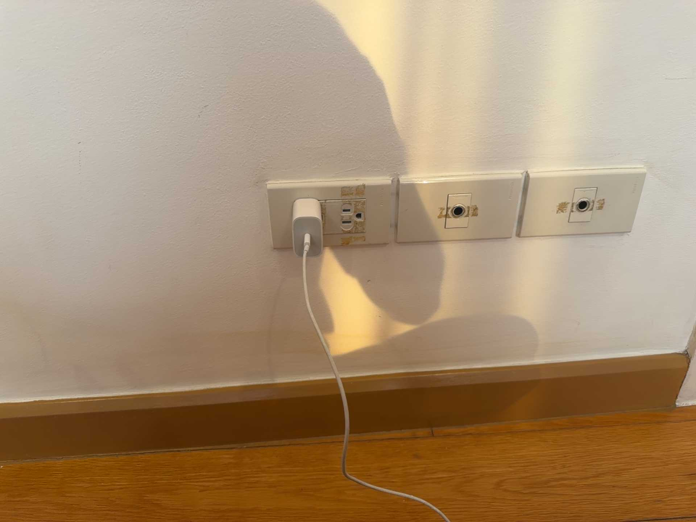
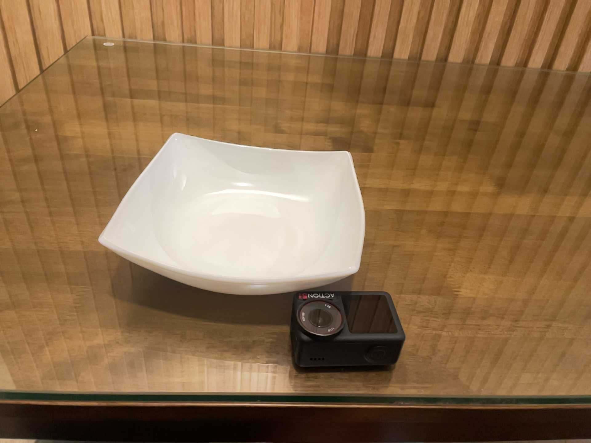

# Recent iPhone depth: small recorded-input comparison

**Completed result, not a navigation benchmark.** Eight fixed frames from a publisher-labeled iPhone 17 Pro recording were tested with the same native depth policy as eight fixed frames from a 12 Pro recording.

| Recorded sample | Native-policy admitted pixels | Full-raster high confidence |
|---|---:|---:|
| 17 Pro, EM1-1093 | **86,236 / 98,304 (87.72%)** | 87.71% |
| 12 Pro, EM1-0387 | **34,240 / 98,304 (34.83%)** | 34.96% |

**These are unmatched scenes, and confidence is device-relative—not an accuracy score.** The 17 Pro clip shows a nearby wall/wood floor/charger; the 12 Pro clip shows a glass tabletop/bowl/camera. This comparison's 12 Pro is **not** Koivu's 12 Pro Max Polycam export. More accepted pixels here do not establish better hardware, cable detection, safe clearance or a fix for Koivu's mapping failure.

## Start here

1. [Results and limitations](RESULTS.md): actual depth/confidence/timestamp measurements and unchanged-policy outcomes.
2. [Acquisition protocol](ACQUISITION_PROTOCOL.md), [initial selection criteria](PRE_REGISTERED_SELECTION.json), [selected publisher rows](SELECTED_INDEX_ROWS.json), [frozen frame IDs](FROZEN_FRAME_SELECTION.json).
3. [Native protocol](native/PROTOCOL.md), [exact executed Swift harness](native/NativeCameraAudit.swift), [driver](native/run_native_audit.py), [native receipt](native/run/RECEIPT.json), [independent terminal review](native/INDEPENDENT_REVIEW.md).
4. [Original-to-public hash mapping](PUBLIC_NORMALIZATION.json), [normalization/replay limits](PUBLIC_NORMALIZATION.md), [license and privacy review](OWNERSHIP_AND_PRIVACY.md).

### What was checked

The archive SHA matched the pinned publisher entry; selected members passed CRC/decode checks. Native code used original Float32 metres, original confidence exactly 2, inclusive 0.15–5 m and stride 2. All admitted samples projected to finite camera-relative points. Five analytic projection probes and nine scalar probes passed; an independent byte-based predicate check matched every frame's counts. Algebraic roundtrip is an implementation check, **not physical accuracy**.

Both recordings have original 256×192 depth, confidence, timestamps, per-frame intrinsics and ARKit camera poses. Actual metadata identifies LiDAR camera type, but not exact phone model, app/iOS version, smoothing mode, tracking state or body calibration. Device labels are publisher provenance. No ground truth, obstacle labels, body/world mapping, route or physical navigation test is supplied.

### Selection was not confidence-based

No indexed 17 Pro clip fit the initial ideal 32 MiB cap. Before inspecting actual depth, the bounded exception selected the smallest 17 Pro archive: EM1-1093, 55,082,489 bytes. No 12 Pro `plug_charger` clip exists in the pin, so the previously acquired 12 Pro clip was explicitly reused as unmatched. The 73 reported zero-high-confidence 17 Pro clips were not filtered out for their outcome; the smallest exceeds the approved 64 MiB transfer budget. Frame IDs use `floor(k*(N-1)/7)` for `k=0..7` on both clips.

## Verify this packet offline

From this directory, with Python 3's standard library:

```sh
python3 verify_packet.py
```

This checks packet hashes, copied-fixture integrity and agreement between saved arrays and recorded counts. It does not download, decode LZFSE, compile Swift, rerun the native experiment or test navigation. Historical executed sources remain unchanged; normalized manifests do **not** satisfy their original private-path-dependent input hashes. See [replay limits](PUBLIC_NORMALIZATION.md).

## Included data and omitted artifacts

Included: all sixteen selected original RGB/depth/confidence triples, both original metadata files, decoded arrays, source cuts, receipts, decoder source/provenance and independent results. Dataset: CaryX AI, *Everyday Manipulation 3D (raw RGB-D)*, 2026, [pinned revision](https://huggingface.co/datasets/CaryxAI/everyday-manipulation-3d-raw/blob/a285cd1249fe9762085713a1c796ab68b1810ac2/README.md), [CC BY 4.0](https://creativecommons.org/licenses/by/4.0/).

**Neither complete `.r3d` archive is included.** The 55 MB 17 Pro original and 14 MB 12 Pro original have exact immutable URLs, sizes and hashes in [OMITTED_ARTIFACTS.json](OMITTED_ARTIFACTS.json). No repository release mirror is claimed. Binaries, compiler/runtime, libraries and caches are omitted.

### Original scene examples—not obstacle annotations

| 17 Pro, original frame 0 | 12 Pro, original frame 0 |
|---|---|
|  |  |

The images expose the comparison's scene confound; they are not reference geometry or scored detections. See [primary-source interpretation notes](SOURCE_AND_INTERPRETATION_NOTES.md) and the [17/18 camera distinction](CAMERA_SPEC_NOTE.md).
